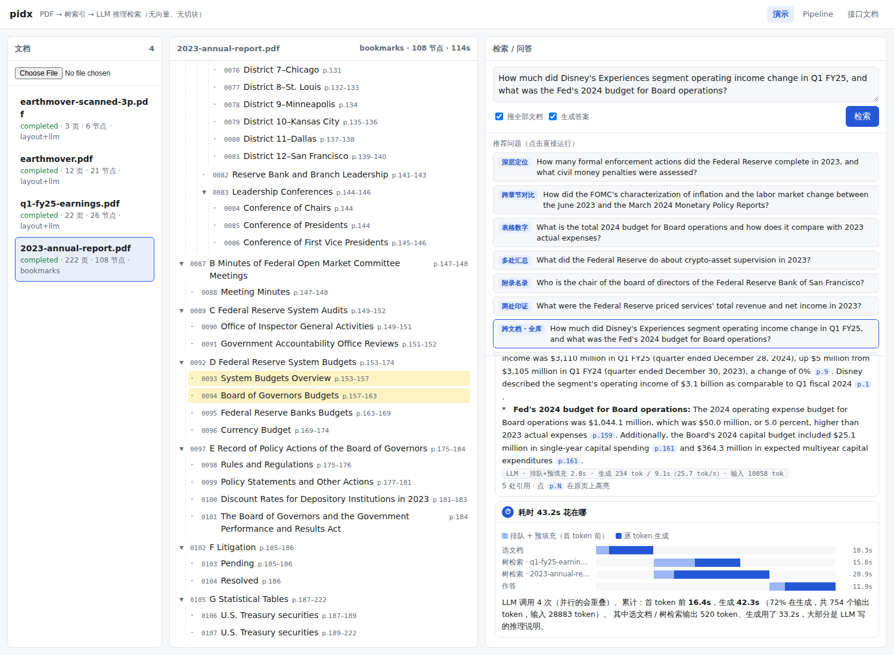

# pidx — PageIndex 式的树索引 RAG 服务

把 PDF 建成一棵**章节树**，提问时让 LLM **读树推理**该看哪几节，再读原文作答。不切 chunk、不用向量库，答案里的论断附**版面块级引用**（页码 + 坐标框），点开就能在原页上高亮。

思路来自 [VectifyAI/PageIndex](https://github.com/VectifyAI/PageIndex)（MIT），接口形状也和它对齐（`submit / get_tree / get_page_content / get_block`），另外加了 `search`。实现是独立写的，建树、扫描件 OCR、检索流程都不同，见下面的[工作原理](#工作原理)。



## 目录

- [能做什么](#能做什么)
- [快速开始](#快速开始)
- [准备 key](#准备-key)（每个 key 从哪儿来）
- [使用方式](#使用方式)
- [工作原理](#工作原理)
- [外部依赖一览](#外部依赖一览)
- [项目结构](#项目结构)
- [开发指南](#开发指南)
- [部署](#部署)
- [已知局限与 TODO](#已知局限与-todo)

## 能做什么

- **建索引**：上传 PDF，后台异步生成章节树。每个节点有标题、页码范围、摘要，原文按位置精确切片。
  - 文本型 PDF：用 PyMuPDF 在本地解析；
  - 扫描件 / 纯图片 PDF：交给 MinerU 做 OCR 和版面分析。
- **检索 / 问答**：单文档或全库。多文档时 LLM 先挑文档，再在树上选节点、读原文、作答。证据不足时会说明缺什么，再补搜一轮。
- **引用到块**：答案里的 `[1:p42_b2]` 对应第 42 页第 2 个版面块，带 bbox；演示页可以点开大图高亮。
- **过程可视化**：`/v1/search/stream` 用 SSE 推送每一步。演示页实时展示 LLM 的推理、命中的节点、读入的原文、逐字输出的答案，最后给出延迟瀑布图。
- **接口**：REST + SSE + MCP server + 命令行。服务自带两页文档：`/api-docs` 是接口说明，`/pipeline` 是流程讲解。

实测（13 道演示问题，见 `pidx/web/suggestions.json`）：检索用 DeepSeek V4 Flash 时平均 **3.9 秒**、13/13 答对；用 Atria 时平均 37 秒。

## 快速开始

环境：Python ≥ 3.10（已在 3.12、3.14 上测过），Linux / macOS。不需要 GPU，所有模型都是调 API。Ubuntu 自带的 Python 如果报 `ensurepip is not available`，先 `sudo apt install python3.12-venv`（版本号按实际），或者用 conda / uv 的 Python。

```bash
git clone git@github.com:qhjqhj00/pidx.git && cd pidx
python3 -m venv .venv && .venv/bin/pip install -r requirements.txt

cp .env.example .env          # 然后按下一节「准备 key」填 key
scripts/fetch_samples.sh      # 下载演示 PDF 到 samples/，并生成一份 3 页扫描件
scripts/serve.sh start        # 启动服务，默认 :8890（日志 logs/server.log）
.venv/bin/python scripts/smoke.py   # 冒烟测试：上传 → 建索引 → 提问，最后打印「通过 ✅」
```

打开 <http://127.0.0.1:8890/>：上传 PDF，或者用命令行导入演示文档：

```bash
for f in samples/*.pdf; do .venv/bin/python -m pidx index "$f" --no-wait; done
```

导入后，选中左侧文档，点「推荐问题」就能看到完整的检索过程。

**最小配置**：只填 `DEEPSEEK_API_KEY`，再把建索引也指向 DeepSeek（`.env` 里打开 `PIDX_LLM_*` 那三行），就能跑通文本型 PDF。向量和 OCR 的 key 都是可选的。

## 准备 key

所有 key 都放在项目根目录的 `.env` 里（从 `.env.example` 复制）。`.env` 已被 `.gitignore` 忽略，**不要提交**。

| 变量 | 用途 | 必需？ | 从哪儿来 |
|---|---|---|---|
| `ATRIA_API_KEY`（及 `ATRIA_BASE_URL`、`ATRIA_MODEL`） | 建索引用的 LLM：建树、节点摘要、文档描述。调用量大，但没人在等 | 和下一行二选一 | 团队自己的 Atria 网关，**免费，但只在团队 tailnet 内可达**。团队成员：在 agent-hub 里 `hub_vault env atria-gateway` 导出，或者找 Tommy 要。用法见 hub 笔记 `atria-gateway-howto` |
| `PIDX_LLM_BASE_URL` / `PIDX_LLM_API_KEY` / `PIDX_LLM_MODEL` | 同上，换成任意 OpenAI 兼容端点（设置后优先于 `ATRIA_*`） | 和上一行二选一 | 不在 tailnet 内就用这个，比如直接填 DeepSeek（见下一行）。注意费用：一份 200 页的文档建索引大约 100 多次调用、20 万输入 token |
| `DEEPSEEK_API_KEY` | 检索 / 问答（选文档、树检索、作答），比 Atria 快约 10 倍 | 推荐 | 在 <https://platform.deepseek.com> 注册 → 左侧「API keys」→ 创建 → 充值后可用（按 token 计费）。团队成员也可以用共享 key：`hub_vault env deepseek` |
| `SILICON_FLOW_API_KEY` | 向量（`BAAI/bge-m3`）：建索引时给文档描述算向量；库里超过 20 篇文档时用来粗筛 | 可选，不填就跳过向量（目前文档少，没有影响） | 在 <https://cloud.siliconflow.cn> 注册 → 「账户管理 → API 密钥」→ 新建。新用户有赠送额度，价格以官网为准。接口文档：<https://api-docs.siliconflow.cn/docs/api/embeddings-post> |
| `MINERU_API_KEY` | 扫描件 / 纯图片 PDF 的 OCR 和版面分析（mineru.net 云端 API） | 可选，不填则扫描件无法索引，文本型 PDF 不受影响 | 在 <https://mineru.net> 注册登录 → 「API 管理」<https://mineru.net/apiManage> → 创建 API Token（注意页面上显示的有效期，过期要重新生成）。每天 1000 页高优先级额度，单个文件最多 200 页（超出的 pidx 会自动切段）。也可以不用云端，自建 MinerU 后设置 `PIDX_MINERU_URL` |
| `PIDX_PUBLIC_TOKEN` | 经反代挂到公网时的访问 token | 只在公网部署时需要 | 自己生成：`python3 -c "import secrets; print(secrets.token_urlsafe(18))"` |

> 团队成员：`SILICON_FLOW_API_KEY` 和 `MINERU_API_KEY` 目前是 Tommy 的账号，需要的话找他要，或者自己注册一个（都有免费额度）。

检查哪些模型已经生效：服务启动后访问 `GET /v1/llm`，或者看 `scripts/smoke.py` 的第一行输出。

## 使用方式

**Web 演示页**：`http://127.0.0.1:8890/`。上传、看树、提问，可以切换检索用的模型，点击引用会弹出原页高亮。`/pipeline` 是流程讲解，`/api-docs` 是接口文档。

**命令行**（需要服务在运行；`PIDX_API` 指定服务地址，默认 `http://127.0.0.1:8890`）：

```bash
.venv/bin/python -m pidx index report.pdf [--mode auto|text|ocr] [--no-wait]
.venv/bin/python -m pidx tree pi-xxxxxxxxxxxx
.venv/bin/python -m pidx ask "问题" [--doc pi-xxxxxxxxxxxx ...] [--no-answer]
```

**HTTP API**（完整说明见服务内的 `/api-docs`）：

| 接口 | 说明 |
|---|---|
| `POST /v1/documents` | 上传 PDF（multipart：`file`，可选 `mode`、`summary`、`metadata`），返回 `doc_id`，后台建索引 |
| `GET /v1/documents[/{id}]` | 列表 / 状态（`queued → processing → completed / failed`），`info` 里有建树方式、耗时、LLM 用量 |
| `POST /v1/documents/{id}/reindex` | 重建索引，期间旧树仍可检索 |
| `DELETE /v1/documents/{id}` | 删除 |
| `GET /v1/documents/{id}/tree?node_summary=&include_text=` | 树 |
| `GET /v1/documents/{id}/pages?pages=5-7,9` | 页文本 |
| `GET /v1/documents/{id}/blocks/{p3_b5}` | 版面块（bbox 为千分比坐标，左上原点） |
| `GET /v1/documents/{id}/pages/{n}/image?highlight=p3_b5` | 页图，可高亮块 |
| `POST /v1/search` | `{query, doc_ids?, top_k=5, answer=false, max_rounds=2, include_text=true, llm?}`，响应里带 `timing` 延迟分解 |
| `POST /v1/search/stream` | 同上，以 SSE 推送每一步 |
| `GET /v1/llm` | 可选的检索模型 |

```bash
curl -F file=@report.pdf http://127.0.0.1:8890/v1/documents
curl -X POST http://127.0.0.1:8890/v1/search -H 'Content-Type: application/json' \
  -d '{"query": "2024 年预算是多少？", "answer": true, "include_text": false}'
```

**MCP**（给 Claude Code 等 agent 用；工具有 `list_documents`、`get_tree`、`get_pages`、`search`）：

```bash
claude mcp add pidx -e PIDX_API=http://127.0.0.1:8890 -- $PWD/.venv/bin/python -m pidx.mcp_server
```

## 工作原理

详细讲解（含流程图和阈值）见服务内的 `/pipeline` 页面，这里是简版。

**建索引**（`pidx/parse.py`、`pidx/tree.py`）

1. **解析**：文本型 PDF 用 PyMuPDF 取出字符片段，按基线重组成行，记录字号、粗体、块 bbox，并去掉页眉页脚和页码。每页平均不到 80 个字符的判为扫描件，交给 MinerU。
2. **建树**：依次尝试，前一种不成立才用下一种：
   1. 用 PDF 书签；
   2. 从版面里挑标题候选（字号、粗体、编号；MinerU 给出的标题层级），交给 LLM 选出真标题并定层级。LLM 只能返回候选编号，所以每个标题都锚定在真实的一行上；
   3. 让 LLM 直接读页面文本找标题，每个标题都回原页核对，对不上的丢弃。
3. **拆分**：超过 10 页或 2 万 token 的叶子节点，在其范围内递归再拆，最多 3 层。
4. **摘要**：给每个节点写摘要，给整份文档写描述，并算一个向量。

**检索**（`pidx/search.py`）

1. **选文档**（多文档时）：LLM 读各文档的描述，挑出要查的；超过 20 篇时先用向量粗筛。
2. **树检索**：LLM 读树的骨架（标题、页码、摘要）选节点。树太大时分层展开。
3. **读原文**：按版面块取出节点原文，每块打上 `[文档:块id]` 标签。
4. **作答**：答案流式输出，论断后附块标签。最后一行带一个状态标记，说明证据是否充分、缺什么；不充分时排除已读节点，再补搜一轮。

## 外部依赖一览

| 组件 | 在哪儿 | 用在 |
|---|---|---|
| pidx 服务、SQLite、PyMuPDF | 本机 | 接口、存储、文本型 PDF 解析、页图渲染 |
| 建索引 LLM（默认 Atria，或 `PIDX_LLM_*`） | 外部 API | 建树、摘要、描述 |
| DeepSeek V4 Flash | 外部 API | 检索（选文档、树检索、作答），关闭 thinking |
| SiliconFlow `BAAI/bge-m3` | 外部 API | 文档向量（可选） |
| MinerU（mineru.net） | 外部 API | 扫描件 OCR（可选；也可以自建） |

## 项目结构

```
pidx/
  config.py        所有配置（读环境变量和 .env）
  llm.py           OpenAI 兼容的 chat 客户端：重试、JSON 解析、流式、逐次调用打点（Tracer）；向量
  parse.py         PDF → 页 / 版面块 / 行；扫描件走 MinerU（云端或自建）
  tree.py          建树（书签 / 版面候选 + LLM / LLM 读页）、拆分、摘要、文档描述
  indexer.py       建索引流水线 + 后台任务队列（重启后自动续跑未完成的任务）
  search.py        选文档、树检索、读原文、作答、补搜；timing 汇总
  store.py         SQLite：documents（树以 JSON 存储）、pages（页文本 + 版面块）
  api.py           FastAPI：REST + SSE + 页面路由 + 公网 token 鉴权
  mcp_server.py    MCP server（stdio，内部调用 HTTP API）
  __main__.py      命令行：serve / index / tree / ask
  web/
    index.html     演示页（过程时间线、引用弹窗、延迟瀑布图）
    pipeline.html  流程讲解页（含实时统计）
    api.html       接口文档页
    page.css       上面两页的共用样式
    suggestions.json  演示页的推荐问题（按文档名索引，"all" 表示搜全库）
scripts/
  serve.sh          start | stop | restart | status
  fetch_samples.sh  下载演示 PDF，生成扫描件样例
  smoke.py          端到端冒烟测试
  latency.py        跑一遍推荐问题，打印每次 LLM 调用的延迟分解（LLM=deepseek|default）
  debug_tree.py     不启动服务，直接对一份 PDF 建树并打印（调建树逻辑时用）
deploy/
  Caddyfile.example 挂到已有站点子路径下的反代示例
  pidx.service      systemd 用户服务示例
data/               运行时数据（SQLite + 上传的 PDF），已被 git 忽略
```

## 开发指南

- **改代码后重启**：`scripts/serve.sh restart`。服务没有热加载；前端页面是静态文件，刷新浏览器即可。
- **调建树**：`.venv/bin/python scripts/debug_tree.py samples/xxx.pdf`，打印树、建树方式和 LLM 用量，不写数据库。改完 `tree.py` 后，对已有文档调 `POST /v1/documents/{id}/reindex` 看效果。
- **看延迟**：`LLM=deepseek .venv/bin/python scripts/latency.py`（需要先导入演示文档），结果写到 `logs/latency.json`。演示页每次问答的最后一步也有瀑布图。
- **加推荐问题**：编辑 `pidx/web/suggestions.json`，刷新页面即可，不用重启。
- **加检索模型**：在 `config.py` 的 `LLM_BACKENDS` 里加一项（OpenAI 兼容即可），演示页的下拉框和 `GET /v1/llm` 会自动出现。
- **清空数据**：停服务后删除 `data/` 目录。
- **提示词**都在代码里：`tree.py`（`SELECT_PROMPT`、`PAGE_PROMPT`、`SUMMARY_PROMPT`）和 `search.py`（`SEARCH_PROMPT`、`ANSWER_PROMPT`）。
- **约定**：用 `logging`，不用 print；所有 HTTP 客户端都设了 `trust_env=False`，不走系统代理。如果你的环境访问外部 API 必须走代理，改 `llm.py` 和 `parse.py` 里的 httpx 客户端。
- 目前还没有单元测试，提交前至少跑一遍 `scripts/smoke.py`。

## 部署

- **单机**：`scripts/serve.sh start`，或者用 `deploy/pidx.service` 配成 systemd 用户服务。服务监听 `0.0.0.0:8890`，内网可以直接访问。
- **挂到公网**：参考 `deploy/Caddyfile.example`，用反代挂到已有站点的子路径下（例如 `/pageindex/`），并在 `.env` 里设置 `PIDX_PUBLIC_TOKEN`。
  - 经反代进来的请求（带 `X-Forwarded-For`）都要带 token：浏览器用 `…/pageindex/?token=<token>` 打开一次，之后靠 cookie；程序调用用 `Authorization: Bearer <token>`。
  - 本机和内网直连不需要 token。
  - 前端页面里全部用相对路径，所以挂在任何子路径下都能正常工作。
  - 答案是 SSE 流式输出，反代要关掉这个路径的压缩和缓冲（示例里已经处理）。

## 已知局限与 TODO

- **看不了图**：图表里的数字只有出现在图注或 OCR 文本里才能用上，需要接一个视觉模型。
- **没有系统评测**：目前只人工核对了 13 道演示问题。下一步用 10-K 问答集和向量 RAG、开源 PageIndex 做对比。
- **可以省 token**：树检索提示词里问题放在整棵树前面，导致 DeepSeek 的前缀缓存用不上。把树挪到前面，同一文档的多次提问就能命中缓存。
- **字体信息坏掉的 PDF**（比如老的 TeX 文档）只能走「LLM 读页」，层级偶尔会放错。
- **单进程**：任务队列在进程内，SQLite 单文件，适合演示和小规模使用。
